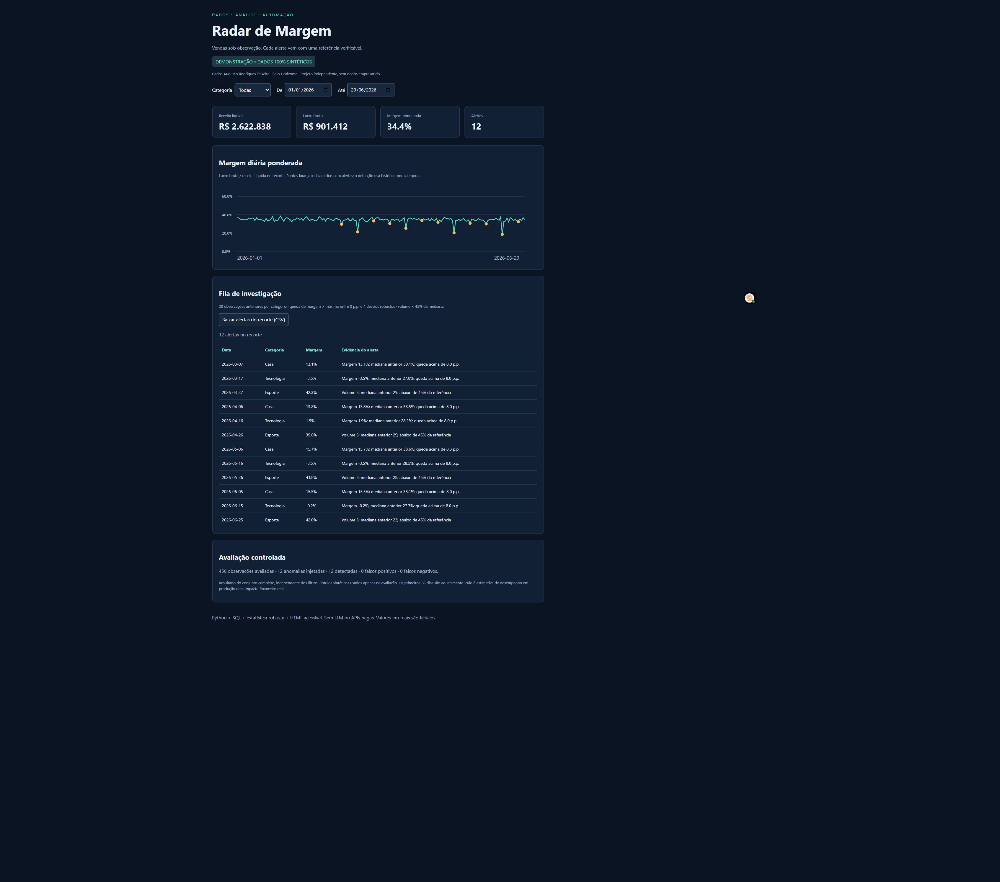
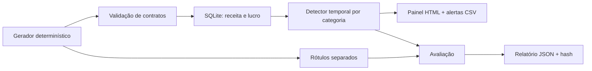

# Radar de Margem

Um projeto de portfólio de **Carlos Augusto Rodrigues Teixeira**, profissional de Dados e IA, Belo Horizonte. Pipeline reproduzível que transforma vendas sintéticas em uma fila explicável de investigação de margem e volume.

**Dados 100% sintéticos. Projeto independente, sem dados da NEOOH ou de qualquer empresa. Não há alegação de ganho financeiro real.**

## Experimente

Abra `demo/index.html` no navegador, inclusive offline. Filtre categoria e período, investigue os alertas e exporte o recorte em CSV. Não requer instalação para visualizar.



## Reproduza

Python 3.10 ou superior. O pipeline usa apenas a biblioteca padrão (SQLite incluído).

```bash
python radar.py
python -m unittest discover -s tests -v
```

O primeiro comando recria `demo/sales.csv`, `ground_truth.csv`, `alerts.csv`, `report.json` e `index.html`. Para outra pasta: `python radar.py --output minha-demo`. Execute na raiz do projeto. A geração usa seed 42 e datas fixas; não depende do relógio ou de APIs.

## Resultado verificado

| Medida | Execução de referência |
|---|---:|
| Observações diárias por categoria | 540 |
| Aquecimento excluído (28 × 3) | 84 |
| Observações avaliadas | 456 |
| Anomalias injetadas | 12 |
| Verdadeiros positivos | 12 |
| Falsos positivos / negativos | 0 / 0 |
| Precisão / recall na simulação | 100% / 100% |
| Testes automatizados | 6 aprovados |

Essas métricas são um teste de sanidade em cenários fortes, planejados e conhecidos. **Não são validação independente, benchmark de IA ou garantia de generalização.** Os limiares são escolhas demonstrativas, não otimizadas em dados reais. O relatório inclui SHA-256 da base canônica para auditoria. O workflow de CI executa testes e verifica se a demo regenerada difere da versionada.

## Arquitetura



Sem modelo treinado ou LLM: mediana e MAD permitem explicar cada alerta e evitam custo de API. Esse é um baseline de detecção, útil antes de introduzir modelos mais complexos.

## Decisões e limites

- Valores monetários de entrada em centavos; receita arredondada no nível categoria/dia. Margem do painel é lucro total dividido por receita total, nunca média simples das margens.
- Apenas as 28 observações anteriores da categoria formam a referência. O dia atual entra no histórico depois da decisão. Os rótulos não entram no detector.
- A base é uma série completa, com uma linha por categoria/dia; não representa pedidos individuais.
- Impostos, frete, devoluções, sazonalidade, rupturas, inflação e múltiplas lojas não são modelados. Lucro bruto aqui significa receita após desconto menos custo de mercadoria.
- O detector sinaliza desvio, não demonstra causa. Desconto e custo são causas conhecidas apenas no gerador; devem ser investigados em dados reais.
- Pipeline em lote, local, sem ingestão externa, agendador instalado, autenticação, alertas enviados ou persistência operacional. A automação entregue é a execução reproduzível e o workflow de CI.

Detalhes: [documentação e dicionário](docs/TECNICO.md). Carrossel: [PDF](docs/radar-margem-carrossel.pdf).

## Evolução proposta

Validar em conjunto temporal independente, introduzir sazonalidade e casos sutis, avaliar por categoria e severidade, adicionar contrato de ingestão real, armazenamento persistente e monitoramento. Medir custo de falsos alertas antes de decisões automáticas.

Construído com assistência de IA na implementação e documentação. Resultados vêm da execução do código e dos testes incluídos.
