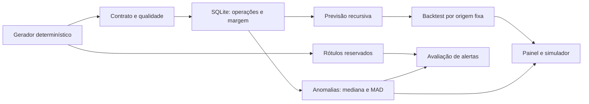

# Radar de Margem Financeiro

Plataforma demonstrativa de inteligência operacional para uma **fintech fictícia**, criada por Carlos Augusto Rodrigues Teixeira (Dados e IA, Belo Horizonte). Conecta qualidade de dados, análise de margem simplificada, anomalias explicáveis, previsão temporal e simulação de cenários em um painel que funciona sem API paga.

**Todos os dados são sintéticos. Não há vínculo com Itaú, Nubank, C6 Bank, NEOOH ou qualquer instituição. Não há registros de clientes, decisões de crédito, detecção validada de fraude nem alegação de impacto financeiro real.**

## Explore a demonstração

- [Painel público](https://carlos1818augusto.github.io/radar-de-margem/) ou `demo/index.html` offline. Use Operação, Previsão, Simulador e Qualidade no menu.
- [PDF explicativo](docs/radar-margem-carrossel.pdf). O vídeo demonstrativo depende da liberação de acesso do navegador ao painel publicado.
- Para apresentar a clientes, use a base fictícia. [Checklist para eventual homologação](docs/HOMOLOGACAO.md).

## Reproduza

Python 3.10+ e Node.js para o teste do simulador. O pipeline usa apenas a biblioteca padrão do Python, incluindo SQLite. Nenhum segredo ou acesso à rede é necessário.

```bash
python radar.py
python -m unittest discover -s tests -v
node tests/test_scenario.js
```

`python radar.py --output outra-pasta` direciona os artefatos para outra pasta. A execução padrão recria `demo/transactions.csv`, `ground_truth.csv`, `alerts.csv`, `backtest.csv`, `forecast_metrics.csv`, `future_forecast.csv`, `quality.json`, `report.json` e `index.html`. Seed 42, datas fixas e SHA-256 permitem conferir a repetibilidade. A CI executa os testes e confere se `demo/` foi regenerada sem diferenças.

## Fluxo técnico



São 180 dias por produto: Transferências, Cobranças e Cartões (540 agregados diários). Cada registro contém tentativas, percentual de falhas, tarifa fictícia por operação bem-sucedida e custo por tentativa. Receita = operações concluídas × tarifa; custo = tentativas × custo unitário; resultado operacional simplificado = receita − custo. O painel calcula margem ponderada como resultado total / receita total. Não é demonstração contábil de banco.

## Resultados medidos nesta simulação

| Verificação | Resultado |
|---|---:|
| Qualidade: chaves únicas / nulos | 540 / 0 |
| Alertas injetados e detectados | 12 / 12 |
| Falsos positivos / negativos nos 456 agregados após aquecimento | 0 / 0 |
| Previsões avaliadas por modelo | 252 (3 produtos × 3 origens × 28 dias) |
| WAPE baseline sazonal de 7 dias | 7,79% |
| WAPE Ridge temporal | 6,45% |
| MAE baseline / Ridge | 240,14 / 198,75 transações por dia |
| Cobertura dos intervalos empíricos baseline / Ridge | 86,90% / 90,48% |
| Testes Python / verificações JS | 12 / 7 |

O Ridge reduziu o WAPE agregado **neste conjunto sintético**, mas perdeu para o baseline em duas das três janelas de Cartões. Os cenários anômalos foram deliberadamente fortes. Nenhuma dessas métricas valida desempenho em produção. As três janelas têm origem fixa e teste de 28 dias, sem usar resultados futuros na previsão; o intervalo usa 14 dias anteriores à origem para uma estimativa empírica, sem garantia de cobertura.

## Decisões e limites

- O baseline sazonal repete os últimos sete dias. A regressão Ridge usa tempo, seno/cosseno semanal, defasagem de sete dias e média dos sete dias anteriores; coeficientes e limiar de regularização são fixos. A previsão de cada janela é recursiva.
- O detector usa as 28 observações anteriores do mesmo produto. Sinaliza falha acima da mediana + 5 p.p., queda de margem superior a `max(8 p.p., 4 × 1,4826 × MAD)` ou volume abaixo de 45% da mediana. Rótulos não entram no detector.
- O simulador aplica premissas editáveis de tarifa, taxa de falha, custo por tentativa e variação de volume à previsão Ridge de 14 dias. **Não estima elasticidade, causalidade ou reação do mercado a uma tarifa**. O volume muda somente quando o usuário altera a hipótese.
- Não há sazonalidade anual, dados faltantes, canais específicos, tributos, capital, risco de crédito, fraude, chargebacks, custo fixo nem conciliação financeira. Os valores de tarifa são inteiramente fictícios e não representam tarifas bancárias reais.
- O painel é público e incorpora a base sintética. Não há login, ingestão de dados externos ou controles para informação confidencial. Não usar com dados reais ou privados sem arquitetura e autorização adequadas.

Leia o [dicionário de dados e método](docs/TECNICO.md) e o [roteiro de homologação](docs/HOMOLOGACAO.md). Código e materiais sob MIT. Implementação e documentação tiveram assistência de IA; as medidas exibidas foram obtidas executando o código e os testes incluídos.
